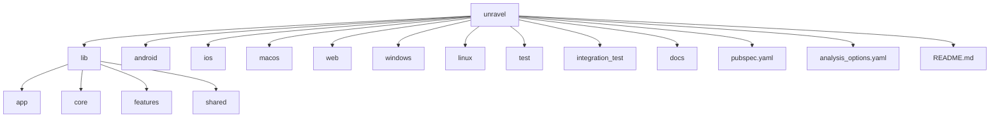

# 项目框架级结构介绍

本文从“框架层”视角梳理当前 Flutter 项目的目录职责、启动链路和平台容器层，方便快速建立整体认知。

## 1. 项目定位

这是一个基于 Flutter 的单仓库多端抽卡 Demo，当前聚焦纯前端展示和交互效果。核心页面、主题、动画和本地演示数据由 `lib/` 下的 Dart 代码承载，后端接口暂不放在本项目中。

项目采用“Flutter 前端 + 独立后端服务”的前后端分离方式。后续接入真实接口时，只需要在数据层增加请求实现，再由页面或状态层消费数据，不需要改变平台容器结构。

## 2. 根目录结构总览

```text
unravel/
├── lib/                 # Flutter/Dart 应用代码
│   ├── app/              # 应用入口、主题接入和底部 Tab 容器
│   ├── core/             # 配置、网络、颜色、主题、模型和 Demo 数据
│   ├── features/         # 按业务功能拆分的页面模块
│   └── shared/           # 跨页面复用的视觉组件
├── android/             # Android 原生容器工程
├── ios/                 # iOS 原生容器工程
├── macos/               # macOS 原生容器工程
├── web/                 # Web 启动页与静态资源
├── windows/             # Windows 桌面容器工程
├── linux/               # Linux 桌面容器工程
├── test/                # 单元测试和 Widget 测试
├── integration_test/     # Integration/E2E 测试
├── docs/                # 项目说明文档
├── pubspec.yaml         # 依赖、资源、版本号配置
├── analysis_options.yaml # Dart / Flutter lint 规则
└── README.md            # 常用启动与打包命令
```

### 2.1 目录树图（高层）



## 3. 应用启动链路

当前应用的启动链路由“启动动画页”和“主应用壳”组成：

1. `lib/main.dart` 里的 `main()` 作为 Dart 入口。
2. `main()` 调用 `runApp(const GachaDemoApp())`。
3. `GachaDemoApp` 注入深色主题，并将 `SplashPage` 设置为首页。
4. `SplashPage` 播放粒子、光环和品牌文字动画。
5. 动画完成后跳转到 `AppShell`。
6. `AppShell` 使用 `IndexedStack` 管理四个 Tab 页面。

这样可以保证 Tab 切换时页面状态不会因为普通路由切换而丢失，也方便未来在主壳中增加登录态、全局弹窗或接口状态管理。

### 3.1 启动流程图

```mermaid
flowchart TD
    A[Flutter 运行时启动] --> B[lib/main.dart]
    B --> C[main()]
    C --> D[runApp(const GachaDemoApp())]
    D --> E[MaterialApp + AppTheme]
    E --> F[SplashPage]
    F --> G[粒子 / 光环 / 品牌启动动画]
    G --> H[AppShell]
    H --> I[探索]
    H --> J[抽卡]
    H --> K[收藏]
    H --> L[我的]
```

## 4. Dart 业务层职责

### `lib/`

这是整个跨平台应用的核心业务层。当前已经按应用层、核心层、功能层和共享层拆分，后续接入真实业务时可以继续在此基础上扩展。

### `lib/app/`

负责应用级装配：

- `app.dart`：MaterialApp、全局主题和启动入口
- `app_shell.dart`：底部导航栏、四个 Tab 和页面状态保持

### `lib/core/`

负责不属于单个页面的基础能力：

- `config/`：编译期环境配置，例如 API 地址、Mock 开关和启动动画开关
- `network/`：HTTP 客户端、JSON 解码、超时和接口异常
- `theme/`：应用颜色和深色主题
- `models/`：抽卡卡片、稀有度等数据模型
- `data/`：当前 Demo 使用的本地静态数据

### `lib/features/`

按业务功能拆分页面：

- `splash/`：启动动画
- `home/`：探索首页、活动和航行数据
- `gacha/`：卡池选择、单抽/十连交互和结果展示
- `collection/`：卡片图鉴、稀有度筛选和卡片网格
- `profile/`：用户资料、等级、成就和设置

其中 `gacha/` 进一步按职责拆分：

- `application/`：`GachaController`，管理请求状态和页面可观察状态
- `data/`：Repository 接口、Mock 实现和真实 HTTP 实现
- `domain/`：卡池、卡片结果等业务 DTO
- `presentation/`：抽卡页面和交互组件

### `lib/shared/`

放置跨页面复用的视觉组件，例如玻璃面板、卡片画面、稀有度徽章、页面背景和底部导航栏。

### `test/`

`test/widget_test.dart` 验证启动动画完成后能进入主应用壳；`test/gacha_controller_test.dart` 覆盖卡池加载、失败重试、单抽/十连和防重复请求。

### `integration_test/`

`integration_test/app_test.dart` 以真实 Flutter Widget 树执行完整流程，覆盖启动动画、四个底部 Tab、抽卡请求结果、SSR 筛选和个人中心。测试通过 `Key` 选择器定位关键交互，避免依赖布局坐标和装饰文本。

## 5. 四个底部 Tab

### 探索

展示用户欢迎区、限时卡池、今日事件和航行统计，是 Demo 的信息流首页。

### 抽卡

展示卡池切换、卡面预览、保底信息，以及单抽和十连按钮。当前按钮使用本地延迟模拟抽卡请求和结果返回。

### 收藏

展示卡片图鉴网格，并支持按 `N`、`R`、`SR`、`SSR` 稀有度进行前端筛选。

### 我的

展示用户资料、探索等级、进度条、成就徽章和设置入口。

## 6. 平台容器层职责

Flutter 的跨平台能力来自“同一套 Dart 代码 + 各平台原生容器”的组合。当前仓库已经生成了多个平台目录。

### Android

`android/` 负责 Android 原生壳工程、Gradle 构建、Manifest、资源和 Kotlin 入口。

关键文件包括：

- `android/app/src/main/kotlin/com/example/unravel/MainActivity.kt`
- `android/app/src/main/AndroidManifest.xml`
- `android/app/build.gradle.kts`

### iOS

`ios/` 负责 iPhone / iPad 的原生壳工程、Xcode 工程配置、Info.plist、Storyboard 和原生插件注册。

关键文件包括：

- `ios/Runner/AppDelegate.swift`
- `ios/Runner/SceneDelegate.swift`
- `ios/Runner/Info.plist`
- `ios/Runner.xcodeproj/project.pbxproj`

### macOS

`macos/` 负责桌面端 macOS 的原生壳工程、窗口启动、签名配置和原生插件接入。

关键文件包括：

- `macos/Runner/AppDelegate.swift`
- `macos/Runner/MainFlutterWindow.swift`
- `macos/Runner/Info.plist`
- `macos/Runner.xcodeproj/project.pbxproj`

### Web

`web/` 负责 Web 端的启动页、图标和 HTML 容器。

关键文件包括：

- `web/index.html`
- `web/manifest.json`
- `web/icons/`

### Windows / Linux

`windows/` 和 `linux/` 分别是桌面端的原生容器工程，负责窗口创建、事件循环和 Flutter 运行时接入。

## 7. 配置层职责

### `pubspec.yaml`

这个文件是 Flutter 项目的核心配置入口，主要负责：

- 应用名称、版本号、描述
- Dart SDK 约束
- Flutter / 第三方依赖
- 静态资源、字体等声明

### `analysis_options.yaml`

这是 Dart 静态检查和代码规范配置入口，决定项目使用哪些 lint 规则。

### `README.md`

这里记录了日常最常用的命令，包括：

- 依赖安装
- 启动应用
- Android / iOS / macOS 打包
- 清理缓存

## 8. 构建与运行视角

从框架层看，Flutter 的构建流程可以理解为：

1. 读取 `pubspec.yaml` 和平台工程配置。
2. 通过 Flutter 工具链生成中间产物。
3. 把 `lib/` 下的 Dart 代码编译进各个平台的运行环境。
4. 由 Android / iOS / macOS / Web / Desktop 容器负责启动宿主壳。

因此，这个仓库的核心原则是：

- 业务代码尽量沉淀在 `lib/`
- 平台差异尽量留在各自的原生目录
- 通用配置集中放在 `pubspec.yaml`、`analysis_options.yaml` 和 `README.md`
- 网络调用集中在 `core/network` 和 Feature Repository，Widget 不直接发请求
- 首屏、页面切换和接口请求都优先控制构建范围、重绘范围和重复请求

## 9. 当前项目状态说明

当前项目已经具备可演示的纯前端抽卡 Demo 骨架，默认数据仍是本地 Mock，但已经具备真实后端接口切换、错误重试和自动化验收基础。后续业务迭代适合继续补：

- 全局状态管理
- 登录态和用户信息
- 抽卡记录、概率和保底状态
- 多环境 / flavor 配置
- 平台差异化能力

接口字段和联调命令见 [`docs/backend-api-contract.zh-CN.md`](backend-api-contract.zh-CN.md)。接口接入建议保持当前目录边界：在 `core/network` 和 Feature 的 `data/` 层实现请求，在 `features/` 的 `application/` 层维护页面状态，避免把网络请求直接写进 Widget 的 `build` 方法。
